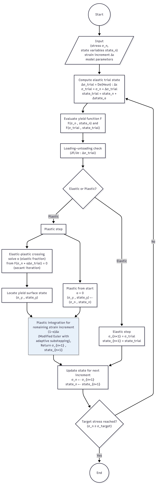
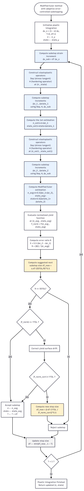
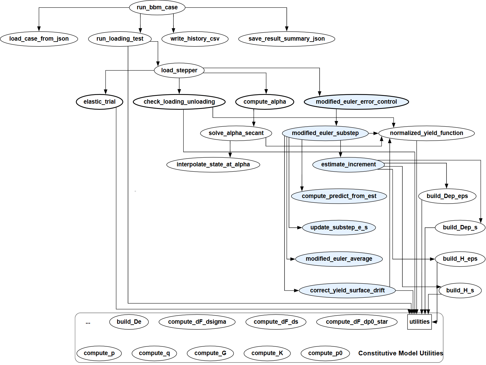
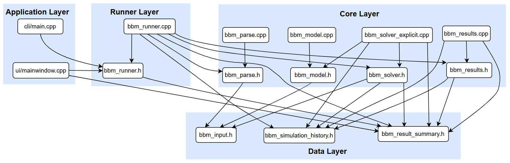
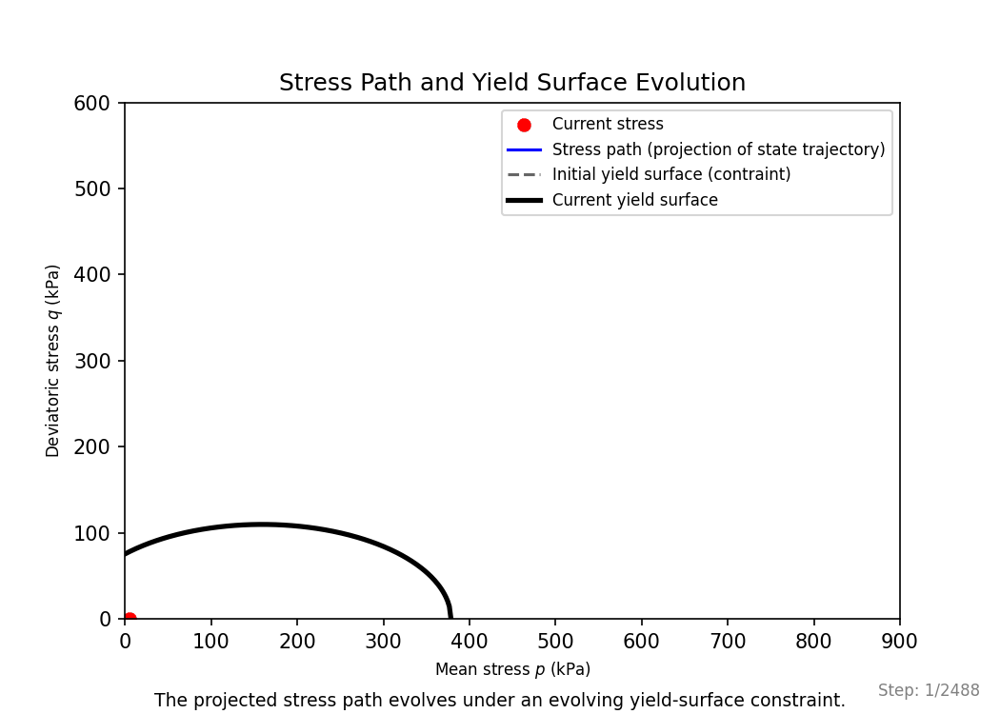
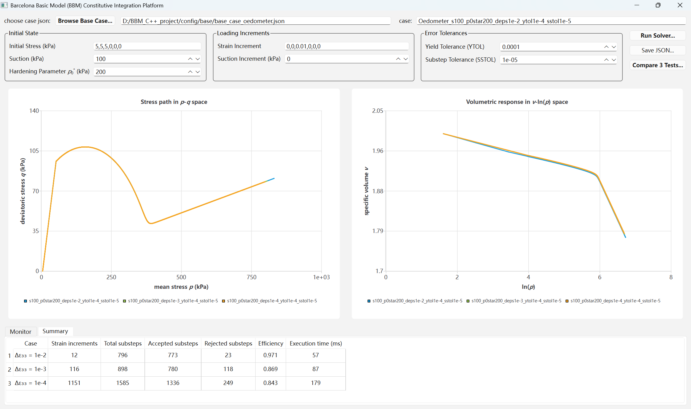
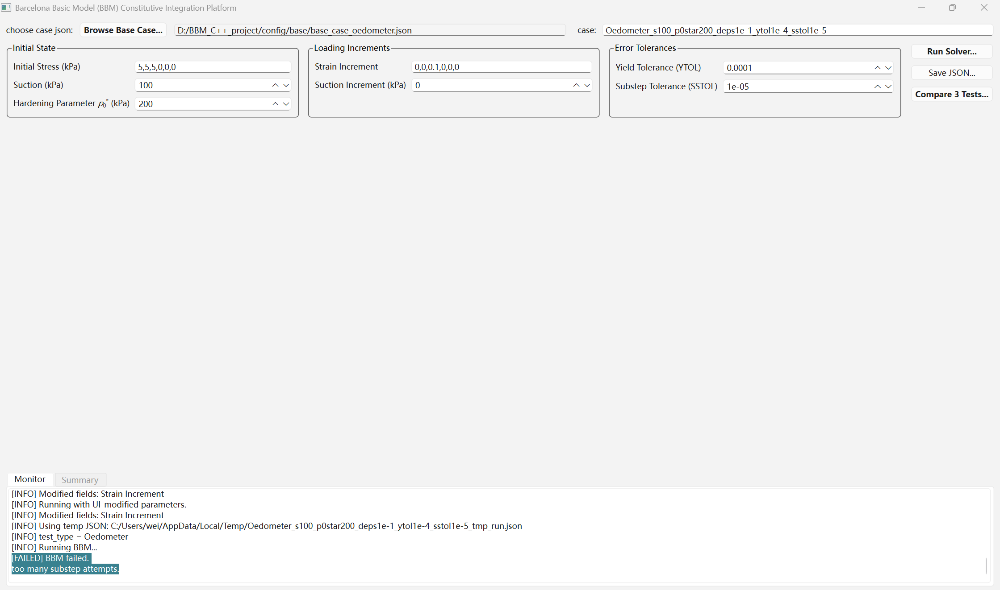
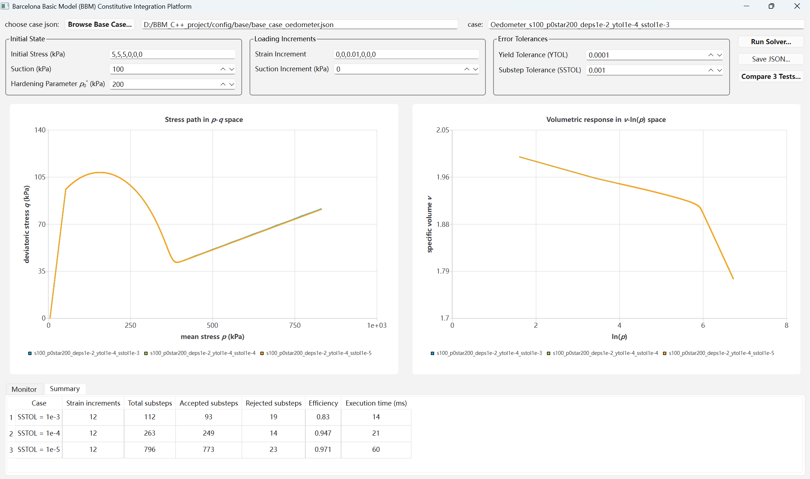
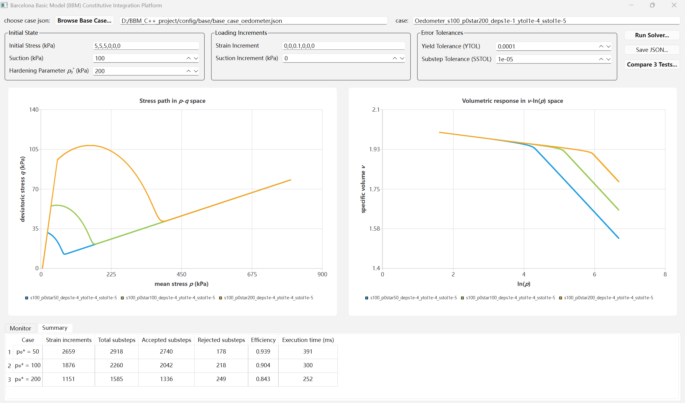

# Numerical Experiment Platform for Nonlinear Elasto-Plastic Constitutive Integration (BBM)
▶ [Watch demo (YouTube)](https://youtu.be/jmR2P-bNt1A) 

## 1. Problem Formulation

Constitutive models define the stress–strain relationship of materials. Many engineering materials exhibit nonlinear and path-dependent stress-strain behavior, which is commonly modeled using elasto-plastic constitutive frameworks. In finite element analysis, this nonlinear response is computed through constitutive integration (stress update) algorithms driven by strain increments.

### 1.1 ODE Formulation of the Constitutive Integration  

$$
\begin{aligned}
\frac{d}{d\varepsilon}
\begin{bmatrix}
\sigma \\
state
\end{bmatrix}
&= f(\sigma, state) \quad \text{(nonlinear evolution equation)} \\
F(\sigma, state) &= 0 \quad \text{(algebraic constraint, yield surface)}
\end{aligned}
$$

The two equations above present the constitutive integration as a strain-driven constrained dynamical system.  
The detailed interpretation and expanded form are provided below.  

Given the current stress and state variables:  

$$
(\sigma_n, state_n)
$$  

and a strain increment:

$$
\Delta\varepsilon
$$   

compute the updated stress and state variables:  

$$
(\sigma_{n+1}, state_{n+1})
$$

by integrating the constitutive evolution equations below along the strain path:  

$$
\frac{d}{d\varepsilon}
\begin{bmatrix}
\sigma \\
state
\end{bmatrix}
=f(\sigma, state)
$$

where 

$$
f(\sigma, state) =
\begin{cases}
\left[\begin{array}{c}
D_e(\sigma, state) \\
0
\end{array}\right] & \text{elastic} \\
\\
\left[\begin{array}{c}
D_{ep}(\sigma, state) \\
h(\sigma, state)
\end{array}\right] & \text{plastic}
\end{cases}
$$

$D_e(\sigma, state)$ and $D_{ep}(\sigma, state)$ denote the elastic and elasto-plastic tangent operators, respectively. $h(\sigma, state)$ describes the evolution of internal variables.

Integrating the constitutive evolution equations over the strain increment gives the following integral form: 

$$
\begin{bmatrix}
\sigma_{n+1}\\
state_{n+1}
\end{bmatrix}=
\begin{bmatrix}
\sigma_n\\
state_n
\end{bmatrix}+
\int_{\varepsilon_n}^{\varepsilon_{n+1}}
\begin{bmatrix}
D_{ep}(\sigma,state)\\
h(\sigma,state)
\end{bmatrix}
d\varepsilon
$$

The integral is expressed using the elasto-plastic operator, since elastic evolution does not involve internal variable updates.

This nonlinear evolution is subject to the yield surface constraint:

$$
F(\sigma, state)=0
$$

### 1.2  Sources of Strong Nonlinearity in Elasto-Plastic Constitutive Integration
- State-dependent tangent stiffness
- Stiffness discontinuity at the yield surface
- Yield surface evolution driven by evolving internal variables

### 1.3 Numerical Challenges
- Stress integration is sensitive to the size of strain increment
 - Large strain increments may cause instability or yield-surface drift

### 1.4 Integration Strategy  

Modified Euler (Heun) method with adaptive error-controlled substepping for plastic integration

The stress integration algorithm follows the procedure described in Potts & Zdravković (1999).

### 1.5 Selected Model: Barcelona Basic Model (BBM)
- Representative nonlinear elasto-plastic constitutive model for unsaturated soils
- Widely adopted in the modeling of unsaturated soil mechanics
- Suction-dependent hardening introduces additional state variables and derivative terms in the constitutive formulation, increasing the complexity of stress integration
- Typically requires user-defined implementation in commercial finite element method (FEM) software
- In this project, the model is implemented to validate a numerical integration algorithm for elasto-plastic constitutive models
- The modular codebase is structured to support extension to other elasto-plastic constitutive models

   ---

## 2. Algorithm Implementation and Software Architecture
### 2.1 Overall Algorithm Flowchart

### 2.2 Flowchart of the Modified Euler Method with Adaptive Error-Controlled Substepping 

### 2.3 Overall Function Call Graph

### 2.4 Layered Architecture and File-Level Dependency Diagram

---

## 3.	Numerical Experiment Design 

| Group | Purpose | Fixed Parameters | Compared Values |
|:------:|---------|------------------|----------------|
| 1 | Sensitivity to integration step size (convergence and stability) | `p₀* = 200kPa`,  `SSTOL = 1e-5` | `Δε₃₃ = 1e-4, 1e-3, 1e-2，1e-1` |
| 2 | Sensitivity to substepping tolerance (SSTOL) | `p₀* = 200kPa`,  `Δε₃₃ = 1e-2` | `SSTOL = 1e-5, 1e-4, 1e-3` |
| 3 | Influence of initial state variable p₀* (physical response) | `Δε₃₃ = 1e-4`,  `SSTOL = 1e-5` | `p₀* = 50, 100, 200kPa` |

All other parameters are kept at their default values and remain consistent within each group.

---

## 4. Stress Path and Yield Surface (State Evolution Animation) 
Stress path and yield surface evolution under a representative loading condition:

The simulated stress path is physically consistent with the expected elasto–plastic behavior:  
- Initially elastic: stress state evolves inside the initial yield surface ($F<0$).
- At yielding: stress state remains on the evolving yield surface ($dF = 0$).  
The stress path appears close to the initial yield surface, because the yield surface changes only slightly at this stage,
- Hardening stage: yield surface expands (internal variable $p_0{*}$ increase), and the stress path follows a relative stable direction governed by the plastic flow rule.

---
  
## 5.	Numerical Experiment Results
### 5.1 Sensitivity to Integration Step Size (Strain Increment)
Applied strain increment: $\Delta \varepsilon_{33}=10^{-4}, 10^{-3}, 10^{-2}$

**In this project, *Efficiency* shown in the UI is defined as the ratio of accepted substeps to total substeps.**

$\Delta \varepsilon_{33}=10^{-1}$

- The simulated curves obtained with different step sizes (strain increment size) almost overlap, indicating that the integration algorithm is robust to the choice of step size.

- Larger step sizes result in shorter runtimes because they significantly reduce the total number of integration steps (strain increments).

- Larger step sizes lead to fewer rejected substeps, resulting in higher efficiency.

- However, when the step size becomes excessively large (e.g., 1e-1), the adaptive substepping fails within the allowed substep attempts, indicating a practical limit for the global step size.

### 5.2 Sensitivity to substepping tolerance (SSTOL)
$SSTOL=10^{-5}, 10^{-4}, 10^{-3}$

- The simulated curves obtained with SSTOL values of 1e-5, 1e-4 and 1e-3 almost overlap, indicating that the solution is insensitive to the substep tolerance within this range.

- Using an excessively small tolerance (e.g., 1e-5) significantly increases the number of substeps and runtime without noticeable improvement in the computed response.

- Moderate tolerance values (e.g., 1e-4 and 1e-3) provide a good balance between computational efficiency and accuracy.

### 5.3 Effect of Initial Internal State Variable p₀* on Model Response
$p_0^*=200, 100, 50$ kPa

The simulated responses are consistent with the expected behavior of the Barcelona Basic Model (BBM):

- Increasing $p_0^{*}$ enlarges the yield surface in the $p–q$ stress space, leading to higher peak stress.

- A larger yield surface delays the onset of plastic deformation, so the stress state remains in the elastic domain for a longer portion of the loading process.

## 6. Demo video
The demo illustrates numerical experiments with the BBM constitutive integration solver:
- Oedometer test (one-dimensional compression with varying integration step size $\Delta \varepsilon_{33}$)
- Different initial internal variable $p_0^{*}$  

▶ [Watch demo (YouTube)](https://youtu.be/jmR2P-bNt1A)  

---

## References  
Potts, D. M., & Zdravković, L. (1999). Finite Element Analysis in Geotechnical Engineering: Theory. Thomas Telford.  
Alonso, E. E., Gens, A., & Josa, A. (1990). A constitutive model for partially saturated soils. Géotechnique, 40(3), 405–430.